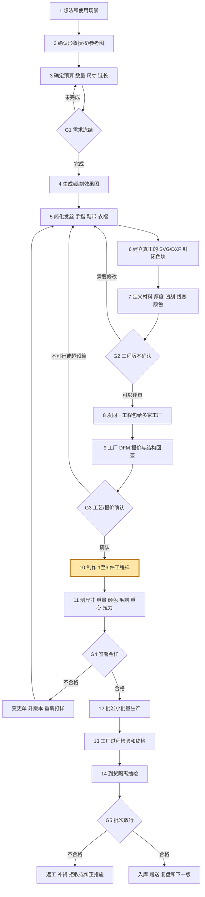

# Hanser 316L 彩色项链工程项目

这是一个从人物图片出发，逐步完成概念设计、制造矢量、工厂询价、工程打样、金样和量产验收的真实项目记录，也可以作为第一次定制金属项链的小白参考模板。

> 饰品行业常把 316L 不锈钢称为“钛钢”，但它不是真正的钛或钛合金。合同、BOM、图纸和材料证明应写明 **SUS316L / 316L stainless steel**，不能只写“钛钢”。

## 当前状态

当前日期：2026-10-15
当前阶段：**G3 工厂工程样进行中，等待收样**

- 当前工程版本：`ENGINEERING-DRAFT-v0.8-80mm`
- 工厂：Supplier-01
- 样品费：150 元
- 报价：50 条 13.5 元/条；100 条 9.8 元/条；20 条尚未报价
- 当前动作：等待工程样，同时确认报价包含范围和打样版本
- 下一关：收到样品后验收；合格才能进入 G4 金样

不要在工程样到手前直接下 20/50/100 条量产单。

## 小白版项链制作流程图



黄色节点是本项目当前所在位置。

## 谁负责什么

| 角色 | 主要责任 |
|---|---|
| 你 | 决定预算、数量、尺寸、形象、供应商、样品是否合格和是否量产 |
| 数字设计/工程协作 | 整理需求、效果图、SVG/DXF、BOM、版本、询价包和验收记录 |
| 工厂 | DFM、真实材料、工艺参数、吊环/结构、打样、量产、检测和问题处理 |

效果图不能替代工程图，工程图也不能替代实物样品；最终量产必须以签字图纸和金样为准。

## 当前工程规格

| 项目 | 当前值 | 状态 |
|---|---|---|
| 主体材料 | SUS316L | 要求工厂提供证明 |
| 图案尺寸 | 80 × 56.72 mm，不含接环 | 工程样验证佩戴性 |
| 总厚度 | 1.90 mm | 已定义，公差待回签 |
| 凹刻/填色槽深 | 0.30 mm | 已定义，公差待回签 |
| 剩余基底 | 1.60 mm | 由截面计算 |
| 内部金属线 | 名义 0.30 mm | 已定义，待验证 |
| 外轮廓金属边 | 名义 0.60 mm，允许 0.50–0.70 mm | 已定义，待验证 |
| 链条 | 60 cm 珍珠链 | 珠体、珠径、串线待定 |
| 扣件 | 单接扣，无延长链 | 扣型和材料待定 |
| 吊挂 | 顶部预留承力接环 | 位置、尺寸、重心待回签 |
| 毛怪爱心 | `#EA6278`，近似 PANTONE 1777 C | 以实体金样为准 |

完整颜色建议见 [颜色与潘通标准](docs/09-color-standard-v0.8.md)，珍珠链与接环参数见 [链条规格](docs/08-pearl-chain-and-bail-spec.md)。

## 这几天完成了什么

1. 建立完整工程目录、G1–G5 关卡、BOM、RFQ、DFM、样品和 QC 模板。
2. 读取动作、人物上下半身和毛怪素材，迭代 Hanser Q 版全身效果图。
3. 调整动作、头身比例、头发模块、手指、爱心和毛怪位置，减少加工风险。
4. 审计 PSD/SVG，发现它们曾是扁平位图或嵌入 PNG，并非真正的矢量路径。
5. 从语义图层重建封闭 SVG/DXF，输出总图和每个工艺层的独立 DXF。
6. 从 40 mm 试验版逐步放大到 80 mm 全细节版，保留金属隔断和五官。
7. 冻结 v0.8 的厚度、凹刻、内外金属线和颜色建议。
8. 建立工程交接 ZIP、哈希清单、截面图、潘通表、BOM 和工厂回传表。
9. 找到 Supplier-01，确认样品费报价 150 元并进入打样等待阶段。
10. 记录 50/100 条报价并建立样品跟踪、范围确认和议价话术。

完整时间线在 [工程变更记录](changes/CHANGELOG.md)，深入复盘在 [项目阶段复盘](docs/10-project-retrospective.md)。

## 本项目遇到的问题

### 1. 图片好看，但不能直接生产

人物插画包含大量细发丝、渐变、阴影、鞋带和手指细节。金属填色需要封闭色块、连续隔断和最小线宽，必须重新工程化。

### 2. PSD/SVG 不一定真的可编辑

早期 PSD 是扁平像素层；后续 SVG 也只是嵌入多张 PNG。必须检查有没有真实 `path`、图层、单位和闭合轮廓，而不能只看扩展名。

### 3. 小尺寸与细节冲突

40 mm 无法稳定保留全部 0.3 mm 级金属隔断，因此工程母版扩大到 80 mm。但尺寸变大又引入重量、重心、佩戴和链条承载问题。

### 4. 版本和参数容易混用

项目经过多个试验版本，0.20 mm 内线已经被 v0.8 的 0.30 mm 取代。工厂打样必须书面引用 v0.8，不能凭聊天截图或旧文件生产。

### 5. 报价不等于到手成本

必须确认单价是否包含吊坠、填色、珍珠链、扣件、接环、包装、税运和不良补货。样品费是否抵货款，也会改变真实单价。

## 小白最容易踩的坑

- 把“钛钢”误认为钛合金，没有在订单写 SUS316L。
- 只发一张 PNG，就让工厂自行猜尺寸、颜色和结构。
- 看到 SVG/PSD 后不检查内容，误以为一定是矢量或分层文件。
- 不做 1:1 纸样，不知道成品实际有多大。
- 只比较总价，不统一数量、材料、链条、包装、税运等范围。
- 没有确认吊环和重心，成品佩戴时侧翻或背面朝前。
- 样品看起来“差不多”就量产，没有记录尺寸、重量、色差和缺陷。
- 工程样还没签成金样，就一次生产全部数量。
- 在聊天里改参数，却没有升版本和重新发受控文件。

## 当前等待期间要做什么

- [ ] 工厂确认打样引用 `ENGINEERING-DRAFT-v0.8-80mm`。
- [ ] 记录样品数量、开工日期、承诺完成日和快递单号。
- [ ] 确认 150 元样品费是否抵量产款、包含几次免费修样。
- [ ] 确认 13.5/9.8 元是否包含完整项链、包装、税和运费。
- [ ] 索取 20 条报价，或重新决定首批数量。
- [ ] 明确珍珠类型、珠径、串线、端头和单接扣型号。
- [ ] 准备卡尺、电子秤、固定光源和 1:1 图纸，用于收样验收。
- [ ] 最好补充至少一家同口径供应商报价，避免单点依赖。

样品跟踪位于 [Supplier-01 样品记录](factory-pack/supplier-quotes/supplier-01/SAMPLE-TRACKER.md)。

## 收到样品后怎么检查

按以下顺序，不要只凭第一眼判断：

1. 核对样品标签和厚工程版本。
2. 测量总高、总宽、度、凹槽和接环尺寸。
3. 称吊坠和整条项链重量。
4. 看金属线是否断裂、粘连、变形或吞掉五官。
5. 看填色是否露底、溢色、有气泡或色差。
6. 摸全部边缘和背面，检查毛刺、锐角、勾衣和残胶。
7. 检查毛怪连接和爱心颜色。
8. 检查 60 cm 珍珠链、端头和单接扣。
9. 实际佩戴，观察是否侧翻、压迫、撞击或链条不承重。
10. 填写 [工程样验收模板](factory-pack/templates/SAMPLE-REPORT.md)，决定批准、修改或重打样。

只有合格样品被编号、拍照、测量并签署后，才是金样。

## 还能进一步做好的方向

- 建立吊坠面积、厚度和密度的重量估算，提前验证珍珠链承载。
- 做吊环位置和质量中心计算，减少侧翻。
- 先做纸样、亚克力或树脂样，降低金属试错成本。
- 同时开发 40–50 mm 简化佩戴版和 80 mm 收藏版。
- 为固定毛怪和旋转毛怪分别制定拉力、扭转和磨损测试。
- 给颜色建立实体限度样，而不是只依赖潘通和 HEX。
- 建立 20/50/100 条完整到手成本模型。
- 未来若对外销售，重新处理 IP 授权和饰品合规测试。

## 关键文件入口

- [当前项目状态](PROJECT-STATUS.md)
- [完整工程流程](docs/01-engineering-flow.md)
- [产品需求表](docs/02-product-brief.md)
- [制造与 DFM 指南](docs/03-manufacturing-dfm.md)
- [质量与验收](docs/04-quality-and-acceptance.md)
- [版本和交付规则](docs/05-versioning-and-deliverables.md)
- [效果图到工程文件](docs/06-concept-to-engineering.md)
- [工程交接指南](docs/07-engineering-handoff.md)
- [珍珠链与接环规格](docs/08-pearl-chain-and-bail-spec.md)
- [颜色与潘通标准](docs/09-color-standard-v0.8.md)
- [项目阶段复盘](docs/10-project-retrospective.md)
- [当前 v0.8 工程包](factory-pack/HN-PENDANT-engineering-handoff-v0.8.zip)
- [当前工厂报价记录](factory-pack/supplier-quotes/supplier-01/QUOTE-2026-10-14.md)

## 目录结构

```text
hanser-necklace/
├─ README.md                     # 小白入口、当前进度和流程图
├─ PROJECT-STATUS.md             # 当前关卡和待办
├─ docs/                         # 流程、规格、DFM、验收与复盘
├─ design/
│  ├─ image/                     # 参考图、AI 迭代图和 PSD/SVG 输入
│  ├─ concept/                   # 概念基线
│  ├─ vector/                    # 各版本制造 SVG/DXF
│  ├─ cad/                       # 后续参数化 CAD/STEP
│  ├─ render/                    # 渲染和 1:1 纸样
│  └─ release/                   # 通过 G2 的只读发布包
├─ factory-pack/
│  ├─ engineering-handoff-v0.8/ # 当前工程交接资料
│  ├─ supplier-quotes/           # 工厂报价和样品跟踪
│  ├─ templates/                 # RFQ、DFM、样品和 QC 模板
│  └─ batches/                   # 打样和量产批次
├─ quality/                      # 金样、检验和检测报告
├─ changes/                      # 工程变更记录
└─ scripts/                      # 矢量重建、DXF 转换和工程打包工具
```

大文件建议使用 Git LFS。供应商电话、收款信息、身份证和地址等隐私内容不要提交到公开仓库。

