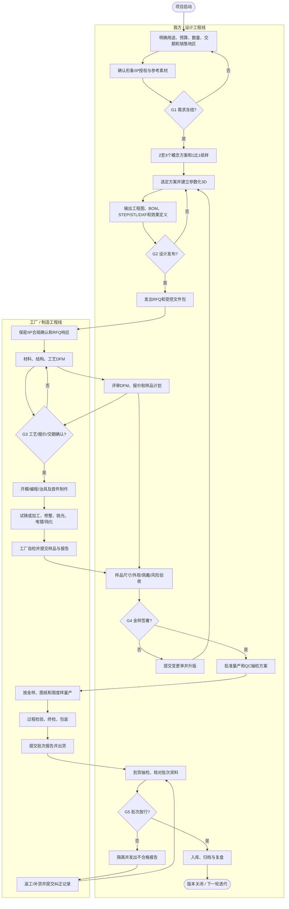
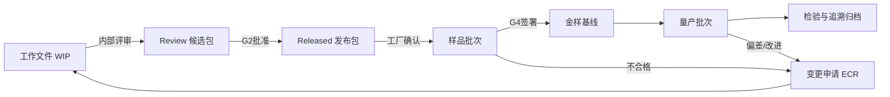

# 完整工程流程

> 当前项目位置（2026-10-15）：**G3 工艺/报价已初步确认，Supplier-01 工程样制作中，等待收样验收。** 工程样不是金样，未通过 G4 前不得批准量产。

## 两条工作线

- **我方/设计工程线**：定义需求与合法素材，完成造型、结构、图纸、BOM、版本、评审和验收。
- **工厂/制造工程线**：材料和工艺可行性、报价排期、DFM、模具/程序、打样、量产、检测和出货。

“我方”可以是你本人、设计师或后续协作者；职责归属不因具体执行者变化。

## 实际分工边界

本工程包把项目压缩成两条主线，但仍有少数决定必须由你本人做：

| 角色 | 负责内容 |
|---|---|
| 我（数字设计/工程协作） | 帮你梳理需求；根据经授权参考制作概念方案；建立/检查矢量、3D、工程图和 BOM；整理 RFQ；比较报价和 DFM；检查工厂回传资料；维护版本与变更记录；依据照片和数据协助判定样品 |
| 工厂 | 给出真实制造参数；采购和证明材料；制作模具/治具；打样和量产；执行抛光、焊接、PVD/钝化等工序；过程检验；提供实物、批次记录和检测资料；处理不合格品 |
| 你必须拍板 | 预算、数量、交期、形象授权、最终造型、佩戴偏好、供应商选择、金样实物批准、付款和收货放行 |

我不能替代对实物的触摸、试戴和实验室检测；远程判断必须基于你或工厂提供的清晰照片、测量数据和报告。

## 端到端流程图

## 五个关卡及退出条件

| 关卡 | 必须具备 | 谁批准 | 未通过怎么办 |
|---|---|---|---|
| G1 需求冻结 | 用途、数量、预算、交期、尺寸区间、形象授权、销售地区明确 | 我方 | 保持概念阶段，不建精细 3D |
| G2 设计发布 | 受控 PDF 图纸、3D/2D 文件、BOM、表面处理、关键尺寸和版本号一致 | 我方设计负责人 | 修订源文件并整体升版 |
| G3 工艺确认 | 工厂书面 DFM、材质牌号、工艺路线、单价/MOQ、模具归属、样期和量产期 | 双方 | 比较备选工艺或供应商 |
| G4 金样签署 | 实物样品编号、照片、尺寸记录、重量、颜色/光泽、缺陷限度及签署日期 | 双方 | 变更单 → 新版本 → 重打样 |
| G5 批次放行 | 数量、抽检结果、材质/合规文件、包装、批次追溯合格 | 我方质量负责人 | 隔离、返工、补货或让步接收 |

## 职责矩阵

R=执行，A=最终负责，C=参与确认，I=知会。

| 工作项 | 我方 | 工厂 |
|---|---:|---:|
| 形象授权、参考图、设计意图 | A/R | I |
| 产品尺寸、目标重量、预算、数量 | A/R | C |
| 外观造型、CAD 主数据、图纸版本 | A/R | C |
| 可制造性、缩水/补偿、浇口和工装方案 | C | A/R |
| 316L 原料采购及批次证明 | C | A/R |
| 表面处理配方和过程控制 | C | A/R |
| 金样外观批准 | A/R | C |
| 量产过程检验 | I/C | A/R |
| 到货验收及版本归档 | A/R | C |
| 模具、治具、源文件归属 | 双方合同明确 | 双方合同明确 |

## 文件流与版本门禁

工厂只能按 `design/release/<版本>/` 的发布包生产，聊天截图、效果图或未编号文件不能作为生产依据。

